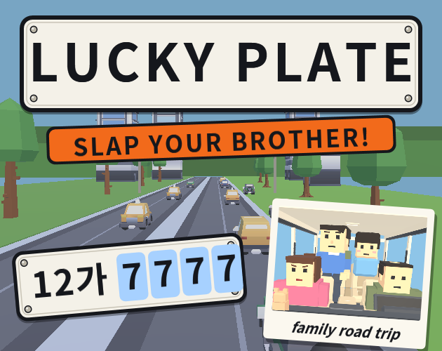
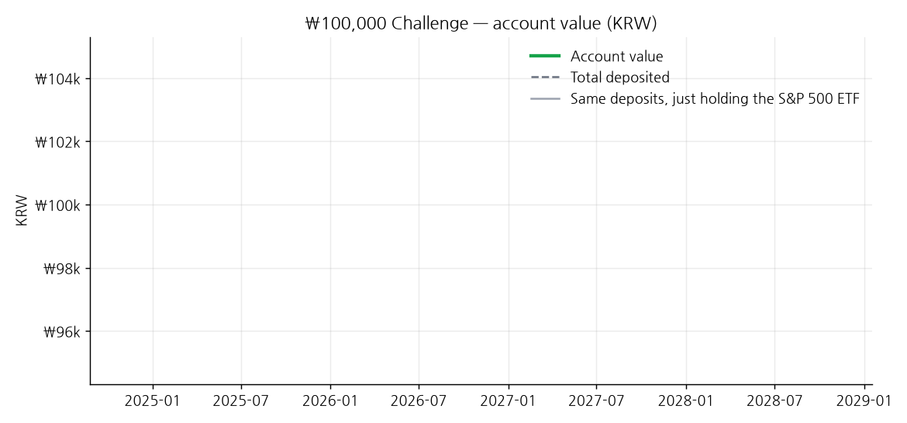
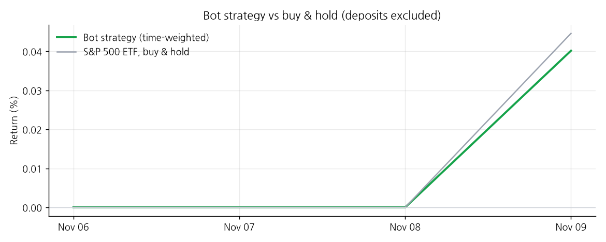
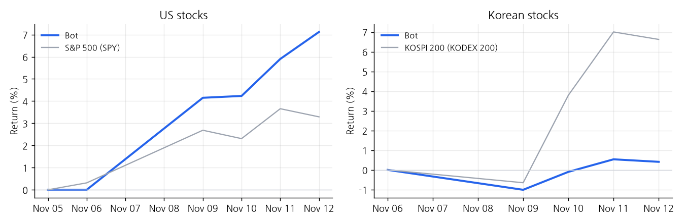

# 👋 안녕하세요! 

- 🔭 **포커스:** 게임 개발 및 백엔드 시스템 구현
- 🌱 **관심 분야:** 엔진 구조, 성능 최적화, 네트워크 프로그래밍

---

### 🛠️ Tech Stack

#### Languages & Game Engine

  
  
  
  
  

#### Frameworks & OS

  
  

---

### 🎮 Featured Game — Lucky Plate

**The license plate game, but your brother cheats.**
Official 2026 Unity Game Jam entry (theme: *Lucky Number*) · solo · Unity 6 · WebGL

- 5 trips from the Corner Mart to Busan, each teaching one new rule
- Spot lucky plates, swipe to slap your brother, catch his lies with **LIAR!**
- Focus slow-mo for oncoming cars, rear-view mirror reading, Holiday / Night replays
- Built with a multi-session AI workflow (Claude Code) — PM / design / art / programmer roles

▶️ **[Play in browser on itch.io](https://chomuscleguy.itch.io/lucky-plate)**

 

---

  

---

<!-- CHALLENGE:START -->

## 💵 ₩100,000 (≈$75) Auto-Trading Challenge

> Started with **₩100,000** on 2026-11-06 and adding **₩100,000 (≈$75) every month**. A Raspberry Pi bot trades a real Korean brokerage account on its own — every number below is real and updated daily. (USD values are approximate, converted at today's rate.)

| | |
|---|---|
| 💰 Account value | **₩100,550** (≈$75) |
| 🏦 Total deposited | ₩99,570 (≈$75) |
| 📈 Profit / loss | **+₩980** (≈$1) (+0.98% of deposits) |
| ⚙️ Bot strategy return (deposits excluded) | +0.98% |
| 📊 Just holding the S&P 500 ETF, same period | +1.09% |
| 🆚 Same deposits, just holding the S&P 500 ETF | ₩100,658 (≈$75) |
| 🧭 Market regime | 🟢 BULL — S&P 500 above its 200-day average → 100% S&P 500 ETF |
| 💱 USD/KRW used above | **1,334.66** (market close 2026-11-12, updated 2026-11-13 07:30 KST) |

### Holdings

| ETF | Shares | Price | Value | Weight |
|---|---|---|---|---|
| 379800 · KODEX 미국S&P500 (S&P 500 ETF) | 4 | ₩22,660 | ₩90,640 | 90.1% |
| Cash | | | ₩9,910 | 9.9% |

How it works

- **Rule:** if the S&P 500 (SPY) closes above its 200-day moving average, hold 100% in a Korea-listed S&P 500 ETF (379800 KODEX 미국S&P500). Below it, move half into a short-term interest-rate ETF (357870 TIGER CD금리투자KIS(합성)).
- The account is in Korean won, so the S&P 500 ETF also reflects the USD/KRW exchange rate.
- Only whole shares are bought, so a small account keeps some cash.
- ₩100,000 is deposited every month and invested automatically the next trading day.
- The comparison line shows what the same deposits would be worth if they had simply bought and held the S&P 500 ETF — i.e. whether the 200-day rule actually helps.
- Full history: [trades](challenge/trades.csv) · [cash flows](challenge/cashflows.csv) · [daily values](challenge/daily.csv)

### 💖 Support

If you enjoy following this, you can [sponsor me](https://github.com/sponsors/chomuscleguy). Donations are **support for the project only** — they are not invested in this account and carry no returns, shares or refunds.

Not investment advice. Personal experiment. Last updated 2026-11-13 07:30 KST.

<!-- CHALLENGE:END -->

<!-- PAPER:START -->

## 🧪 Paper-Trading Bot (simulated money)

> The same bot runs two bigger strategies on Korea Investment & Securities' **paper-trading server** (virtual money) to prove them out before any real money goes in. Rebalanced monthly, and half moves to short-term bonds whenever the index falls below its 200-day average.

| Strategy | Since | Bot return | Benchmark | vs benchmark | Regime |
|---|---|---|---|---|---|
| **🇺🇸 US stocks** — 10 high-conviction stocks from top investors' 13F filings | 2026-11-05 | **+7.12%** | S&P 500 (SPY) +3.29% | +3.83% | 🟢 BULL |
| **🇰🇷 Korean stocks** — Top 10 holdings of Korea's National Pension Service (5%+ stakes) | 2026-11-06 | **+0.41%** | KOSPI 200 (KODEX 200) +6.63% | -6.22% | 🔴 BEAR |

- 🇺🇸 US stocks top holdings: AMD 12%, AVGO 11%, TSLA 10%, AAPL 10%, AMZN 10%, GOOGL 10% · cash 2%
- 🇰🇷 Korean stocks top holdings: KODEX 단기채권 49%, 하나금융지주 5%, 신한지주 5%, 현대모비스 5%, SK스퀘어 5% · cash 14%

Full dashboard: [portfolio-dashboard](https://github.com/chomuscleguy/portfolio-dashboard)

Simulated account, returns only (no amounts). Not investment advice. Updated 2026-11-13 07:30 KST.

<!-- PAPER:END -->
