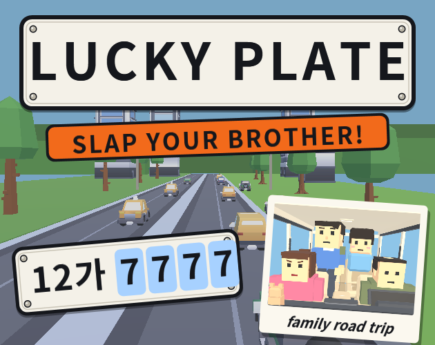
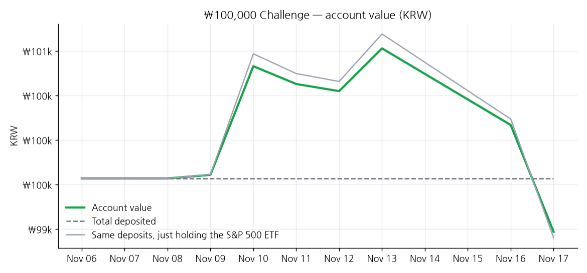
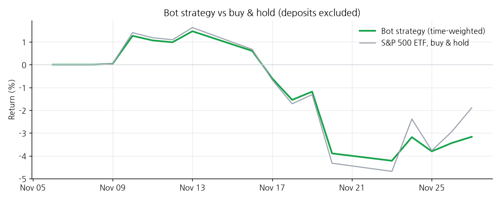
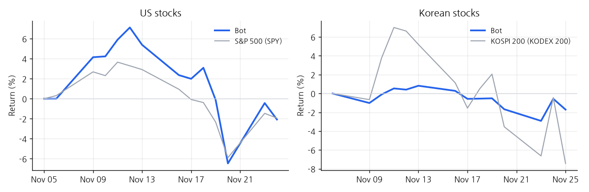

# 👋 안녕하세요! 

- 🔭 **포커스:** 게임 개발 및 백엔드 시스템 구현
- 🌱 **관심 분야:** 엔진 구조, 성능 최적화, 네트워크 프로그래밍

---

### 🛠️ Tech Stack

#### Languages & Game Engine

  
  
  
  
  

#### Frameworks & OS

  
  

---

### 🎮 Featured Game — Lucky Plate

**The license plate game, but your brother cheats.**
Official 2026 Unity Game Jam entry (theme: *Lucky Number*) · solo · Unity 6 · WebGL

- 5 trips from the Corner Mart to Busan, each teaching one new rule
- Spot lucky plates, swipe to slap your brother, catch his lies with **LIAR!**
- Focus slow-mo for oncoming cars, rear-view mirror reading, Holiday / Night replays
- Built with a multi-session AI workflow (Claude Code) — PM / design / art / programmer roles

▶️ **[Play in browser on itch.io](https://chomuscleguy.itch.io/lucky-plate)**

 

---

  

---

<!-- CHALLENGE:START -->

## 💵 ₩100,000 (≈$74) Auto-Trading Challenge

> Started with **₩100,000** on 2026-11-06 and adding **₩100,000 (≈$74) every month**. A Raspberry Pi bot trades a real Korean brokerage account on its own — every number below is real and updated daily. (USD values are approximate, converted at today's rate.)

| | |
|---|---|
| 💰 Account value | **₩96,100** (≈$72) |
| 🏦 Total deposited | ₩99,570 (≈$74) |
| 📈 Profit / loss | **−₩3,470** (≈$3) (-3.48% of deposits) |
| ⚙️ Bot strategy return (deposits excluded) | -3.44% |
| 📊 Just holding the S&P 500 ETF, same period | -2.94% |
| 🆚 Same deposits, just holding the S&P 500 ETF | ₩96,638 (≈$72) |
| 🧭 Market regime | KOSPI 200 🔴 below its 200-day average → new deposits go to bonds instead · S&P 500 🔴 below its 200-day average → new deposits go to bonds instead |
| 💱 USD/KRW used above | **1,343.53** (market close 2026-11-26, updated 2026-11-27 07:30 KST) |

### Holdings

| ETF | Shares | Price | Value | Weight |
|---|---|---|---|---|
| 379800 · KODEX 미국S&P500 (S&P 500 ETF) | 2 | ₩21,755 | ₩43,510 | 45.3% |
| 305080 · TIGER 미국채10년선물 (US 10-year Treasury futures ETF) | 1 | ₩11,875 | ₩11,875 | 12.4% |
| Cash | | | ₩40,715 | 42.4% |

### Recent trades

| Date | Side | ETF | Shares | Price |
|---|---|---|---|---|
| 2026-11-25 | BUY | 305080 (US 10-year Treasury futures ETF) | 1 | ₩11,880 |
| 2026-11-23 | SELL | 379800 (S&P 500 ETF) | 2 | ₩21,365 |

How it works

- **Mix:** follows the 2027 target asset mix of Korea's National Pension Service (alternatives excluded, the rest scaled up) using four Korea-listed index ETFs: KOSPI 200 ETF (dividends reinvested) 24.3% (278530), S&P 500 ETF 41.6% (379800), Korea 3-year government bond ETF 25.5% (114260), US 10-year Treasury futures ETF 8.6% (305080).
- **Deposits:** ₩100,000 is deposited every month and invested the next trading day into whichever ETFs are furthest below target — nothing is sold.
- **Monthly rebalance:** once a month, right after that month's deposit arrives, the deposit fills the gaps first and only ETFs still more than 2 percentage points off target are sold back to target.
- **200-day rule (soft):** if the KOSPI 200 or the S&P 500 is below its 200-day average, that stock ETF is not bought for now and its share of new deposits goes to the bond ETFs instead. Nothing is sold because of it.
- The mix is updated once a year when the pension fund announces new targets.
- The account is in Korean won, so the US ETFs also reflect the USD/KRW exchange rate. Only whole shares are bought, so a small account keeps some cash and drifts from target until deposits add up.
- The comparison line shows what the same deposits would be worth if they had simply bought and held the S&P 500 ETF.
- Full history: [trades](challenge/trades.csv) · [cash flows](challenge/cashflows.csv) · [daily values](challenge/daily.csv)

### 💖 Support

If you enjoy following this, you can [sponsor me](https://github.com/sponsors/chomuscleguy). Donations are **support for the project only** — they are not invested in this account and carry no returns, shares or refunds.

Not investment advice. Personal experiment. Last updated 2026-11-27 07:30 KST.

<!-- CHALLENGE:END -->

<!-- PAPER:START -->

## 🧪 Paper-Trading Bot (simulated money)

> The same bot runs two bigger strategies on Korea Investment & Securities' **paper-trading server** (virtual money) to prove them out before any real money goes in. Rebalanced monthly, and half moves to short-term bonds whenever the index falls below its 200-day average.

| Strategy | Since | Bot return | Benchmark | vs benchmark | Regime |
|---|---|---|---|---|---|
| **🇺🇸 US stocks** — 10 high-conviction stocks from top investors' 13F filings | 2026-11-05 | **-3.04%** | S&P 500 (SPY) -2.22% | -0.82% | 🔴 BEAR |
| **🇰🇷 Korean stocks** — Top 10 holdings of Korea's National Pension Service (5%+ stakes) | 2026-11-06 | **-2.02%** | KOSPI 200 (KODEX 200) -7.10% | +5.08% | 🔴 BEAR |

- 🇺🇸 US stocks top holdings: SGOV 49%, AVGO 5%, TSLA 5%, NVDA 5%, GOOGL 5%, MSFT 5%
- 🇰🇷 Korean stocks top holdings: KODEX 단기채권 51%, 하나금융지주 5%, 신한지주 5%, 셀트리온 5%, 현대모비스 5% · cash 15%

Full dashboard: [portfolio-dashboard](https://github.com/chomuscleguy/portfolio-dashboard)

Simulated account, returns only (no amounts). Not investment advice. Updated 2026-11-27 07:30 KST.

<!-- PAPER:END -->
